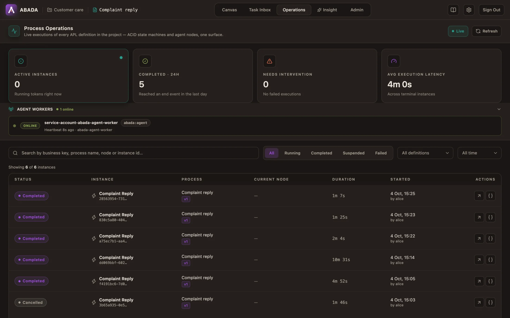
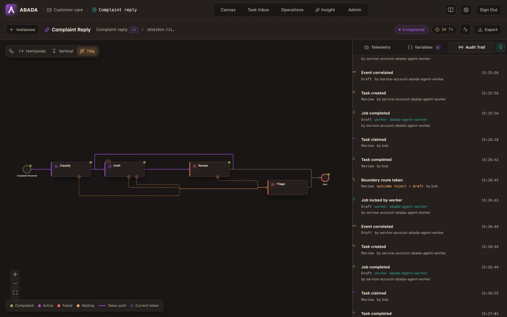

import { Aside } from '@astrojs/starlight/components';

Everything a running process does is stored in PostgreSQL first and shown in
Studio second. This page is the operator's guide: where to look, what each
state means, and how to unblock an instance.

## The Operations view

**Operations** opens on six figures, each with its last 24 hours as a small
line. Click the **i** on a figure to see where it comes from.

| Figure | What it counts |
| --- | --- |
| Running | Instances running now (exact) |
| Completed | Instances started in the last 24 hours that completed. Studio reads at most the newest 1 000; beyond that the figure shows **≥** |
| Open incidents | Open [incidents](#incidents) of the project (up to 100, then **100+**) |
| Waiting on you | Tasks you can claim. The engine lists only the tasks of your users and groups, so this is not every human step of the project |
| p95 duration | 95th percentile run time of the last 100 completed instances |
| AI cost | Priced agent calls of the instances started in the last 24 hours; **+** when some calls have no price |

Studio computes these from the existing API lists; the figures follow the
project's event stream and the 24-hour lines refresh every minute.

Below them, **Needs attention** shows the most urgent open incidents as cards,
most severe first: **Needs a decision** (an interrupted write only a person can
settle), **Blocked** (work used up its attempts or a called process failed),
**Waiting** (a loop limit or a missing correlation key). Click a card to open
its instance on the failing step; **All incidents** lists every open incident
with its actions. **Workers** shows each worker topic: online, failing (with
its last error) or offline, and when it was last seen.



Then the instances, newest first. Filter with the chips: state (with counts),
process and, once a process is chosen, its version; or pick a start-time range
and search by business key, step or instance id. The version, time range and
search filter the instances already loaded; more load as you scroll. A state
pill pulses once when an instance changes state.

Keyboard: `j` / `k` (or the arrows) move through the list, `Enter` opens the
instance, `/` jumps to the search. Coming back from an instance puts you on the
row you left. **Versions & rollback** in the header opens the version history
of each process.

| Worker state | Meaning |
| --- | --- |
| Online | The worker polled recently |
| Error | Its last fetch was rejected (identity, permission or configuration) |
| Offline | No recent heartbeat |

## One instance

Open an instance to see the path it took on the canvas. The header stays in
place: the instance's state, process and version, who started it, the elapsed
time, the playback pace, an incident chip when one is open, and the actions
your role allows. The audit trail runs down the right side. The tabs at the
bottom of the canvas open a drawer over it: **Step**, **Variables**,
**Lineage** and **Versions**. Esc closes an incident card first, then the
drawer, then goes back to Operations.

The canvas draws three layers, told apart by shape as well as colour:

- **Path taken** — thick solid edges on top of the diagram and filled nodes,
  each with its step number (`2`; `2 ×3` when it ran three times; hover for
  every step, "2, 5, 8"). A decision's taken branch reads `✓ score >= 750`; a
  join shows how many branches arrived (`2/2`); a delegation or for-each shows
  its child results (`3 ✓ · 1 ✗`).
- **Where it is now** — a glowing ring where a token runs, amber with a person
  where a human task waits, red with a warning sign at an incident, a filled end
  marker where it finished.
- **Not reached** — faded, thin dashed edges. Hover a faded step to read it and
  why it was not reached ("the else branch was taken at Check score"); **Full
  diagram** in the legend turns the fading off.

Since 1.2 the engine records every flow a token takes, so the path is a fact,
including parallel branches and loops. An instance started before 1.2 shows
**Path reconstructed** in the legend: its path is inferred from the steps it
touched. The same layers appear during a **Dry Run** in the designer.

- **Step** — for the selected step (click it, or walk the steps with ← and →): its configuration and, for an agent,
  each attempt: model and provider, attempt number, latency, confidence
  against the threshold, the output contract result, token counts, prompt
  hash and worker. When a fallback model answered, **Fallback for** names the
  model it replaced. For a decision table: the last decision (the rule that
  matched, its condition and outputs) and the output variables' current values.
- **Variables** — the instance's current variables as a tree: objects and
  lists open and close, with their size (`{4}`, `[12]`). **Expand all**,
  **Collapse all** and **Expand to level** set how much is open. Search finds
  keys and values, marks each match, opens the branches that hold it and
  steps through the matches with ↑ and ↓ (or Enter). Long text is cut, with
  **show more**. Each row offers **Copy value** and **Copy path**; the path is
  the one an expression uses (`applicant.address.city`, `items[2].sku`).
  **JSON** shows the same values as formatted JSON with line numbers and
  folding; **Copy** copies all of it. When a value changes while you watch,
  its row flashes once and keeps a dot, and the drawer lists the changed paths
  ("Changed in the last update"). The Studio compares two reads of the
  variables, so a change appears once the diagram has replayed up to it; while
  the replay is behind, the drawer says the values are the current ones. With
  the keyboard: ↑ ↓ to move, → and ← to open and close, `c` and `p` to copy the
  value or the path, `/` to search.
- **Lineage** — the processes that called this instance and the ones it called.
- **Versions** — the versions of the process, with this instance's marked. An
  instance stays on the version it started on.
- **Audit Trail** — open by default, beside the canvas. It tells the run step
  by step: one entry each time a token passes through a step, with who acted
  (the engine, an agent with its model and prompt version, a person, or a
  worker), what happened, when, how long the step waited, and where the token
  went next (`→ Draft (outcome reject)`, `→ Triage (timeout)`). An agent entry
  opens on its model and tool calls; a decision-table entry names the rule
  that matched and its condition, and opens on the rule itself as the
  instance's version declares it (the condition and the outputs it set) and
  the names of the inputs it read — the engine never records input values; a person's entry gives the outcome and whether they commented
  (the comment itself stays in the process variables). Click an entry for the
  facts the engine recorded. Point at an entry to ring its step on the canvas;
  click a step on the canvas to see only its entries. While the instance runs,
  entries arrive with the canvas: a step's entry appears when the step lights
  up. The trail follows them while you are at the bottom; scroll up and it
  stays put, with a **new entries** button to come back.



The same viewer shows every other piece of JSON in the Studio: an agent
step's request and result, a tool call awaiting approval, a task's process
variables, the facts behind an audit entry, and a JSON resource in the project
explorer. A value the evidence policy masked shows as a **redacted** badge; the
value itself never reaches the Studio. The variables endpoint does not mask
variables declared `sensitive`: anyone who may read the instance sees them.

The engine stores attempt metadata in history — never prompts, model responses
or provider keys. Journaled agent calls keep their prompts and results as the
project's evidence policy allows (redacted by default, 30 days), encrypted, and
readable only by `abada-evidence-reader` members.

**Live updates.** While an instance runs, its page follows the project's event
stream and refreshes as soon as something happens; the header shows **Live**.
When the stream is not available (a proxy that cuts long requests, for
example) it shows **Polling** and refreshes every two seconds instead.

**Watching it run.** The engine runs at full speed, often several steps in one
command, but the canvas shows them one at a time so you can follow along. Each
taken edge draws itself once and the step it enters pulses once. Then both
settle into the path style. The branches of a parallel split move together.
The pace control in the header sets how long each step stays on screen:
**Calm** (0.7 s, the default), **Brisk** (0.25 s) or **Instant** (every step
as it happens, the pre-1.2 behaviour). Your choice is kept in this browser and
also applies to the designer's live view and to **Dry Run**.

While the canvas is replaying, the header says so (**replaying — 3 steps
behind**). Click **Jump to now** to see the current state. The replay only
shows states the instance actually passed through, in order, never ahead of
them. Three things are never held back: an incident, the end of the instance,
and a task assigned to you. When one happens, the canvas jumps straight to it.
One exception: a [retry](#on-the-diagram) plays out in full first, so you see it
happen even when the retried step ends the instance. The header status
changes at once; the canvas follows within a few steps.
When you open an instance, it shows the current state at once. Only steps
that happen while you watch are paced. An instance you start with **Deploy &
Start** is different: its page opens right away and plays the run from the
first step, even the steps the engine finished before the page loaded. With reduced motion turned on in your
system, steps still appear one at a time, with fades instead of movement.

**Agent steps.** For an agent step, the **Step** tab lists every model call,
tool call and delegation in order, attempt by attempt: the tool's policy
(read, write, approval required), the state (a write whose outcome is unknown
is highlighted; a proposed call shows who approved or rejected it, and when; a
delegation links to the process it started), tokens and cost, with totals.
Click a step to read its payloads as the evidence policy kept them; that needs
the `abada-evidence-reader` role and every read is recorded in the history.

**Agent cost.** The instance bar shows what its agent calls cost and how many
tokens they used; the telemetry of an agent step lists each call with its
cost. The engine computes cost from the price in effect: yours in **Settings →
Model Prices**, else the public model catalog's (the tab shows each model's
source). A call to a model no source prices shows **unpriced**: the real cost
is higher than the total shown.

### Called processes

An instance started by a **call-process** step shows *Called by* with the
chain of callers up to the root; an instance whose steps called other
processes lists them under *Called processes* with their status. Each one
opens its own instance page. The same tree is available from
`GET /api/v1/projects/$PROJECT_ID/instances/$INSTANCE_ID/lineage`. Cancelling
an instance cancels the processes it called that are still running.

## Instance actions

| Action | In Studio | Effect |
| --- | --- | --- |
| Suspend / Resume | Instance header, or the row in Operations | A suspended instance accepts no completion; late worker reports are rejected and retried after resume |
| Cancel | Instance header, the row in Operations, or the incident card on the failing step | Ends the instance and retires all its open work (tasks, jobs, timers) in one transaction |
| Force fail | The row in Operations | Moves a stuck instance to *Failed*, for a run that must not continue |
| Retry a failed job | The **Step** tab of the failed step | Gives the job one more attempt and resolves its `WORK_FAILED` incident |
| Retry an incident | The incident card on the failing step, or **All incidents** in Operations | Restarts the stopped step; see [Incidents](#incidents) |

These are Operator and Owner actions; other members do not see the buttons,
and the engine refuses them on the API too.

The same actions exist under `/api/v1/projects/{projectId}/instances/{instanceId}`
(`DELETE` to cancel, `PUT …/suspension`) and
`/api/v1/projects/{projectId}/jobs/{jobId}/retries`.

## Incidents

An incident stops one path of an instance until someone acts. The rest of the
instance — other branches, timers — keeps going.

| Incident | Cause | Fix |
| --- | --- | --- |
| `WORK_FAILED` | A step's last attempt failed and the step has no `on_error` | Fix the cause (provider key, quota, worker), then retry |
| `LOOP_EXHAUSTED` | A loop reached `max_iterations` and has no `on_exhausted` | Retry (the step starts a fresh pass) or cancel |
| `MISSING_CORRELATION_KEY` | A message wait has no `correlationKey` value | Set the variable, then retry |
| `CHILD_FAILED` | A called process failed, was cancelled, or could not start (inputs, depth) and the call step has no `on_error` | Look at the child (it is linked from the instance), fix the cause, then retry: a new child starts |
| `TOOL_OUTCOME_UNKNOWN` | An agent write was interrupted and its tool server takes no idempotency key, so it may or may not have happened | Check the target system, then confirm: **It happened** or **It did not happen**. The agent resumes with that fact; the write is never re-sent blindly |

### In Studio

Operations shows the most urgent open incidents as cards under **Needs
attention**; **All incidents** lists every one, newest first: kind, step,
instance, when it opened and the engine's message, with the actions. Click a
card or a step name to open the instance on that step. On an instance's page,
the header shows an incident chip while it has one; click it to open the card
on the failing step.

**Retry** restarts the step: failed work is reopened with a fresh attempt
budget, an exhausted loop starts a fresh pass, a message wait is armed again.
The incident leaves the list once the engine has resolved it; if the engine
refuses the retry, its reason is shown on the incident.

Retry is an Operator or Owner action on the project. Other members see the
incidents without the actions; the engine enforces the same rule on the API.

### On the diagram

When an incident opens, the failing step pulses once, then keeps a red ring and
a warning badge. The canvas moves to it, unless you panned or zoomed in the
last few seconds. A card next to the step shows the kind of incident, how many
attempts failed, the model of an agent step and the engine's message, with the
actions:

| Action | Shown for | Who |
| --- | --- | --- |
| **Retry** | Every incident except an interrupted write | Operator, Owner |
| **Retry on another model** | Failed work on an agent step | Operator, Owner |
| **It happened** / **It did not happen** | An interrupted write (`TOOL_OUTCOME_UNKNOWN`) | Operator, Owner |
| **View details** | A step whose worker reported a failure (agent, engine task) | Every member |
| **Cancel instance** | Every incident | Operator, Owner |

Close the card with **×** or Esc; click the step to open it again. With
incidents on several branches, the newest is focused and each step keeps its
badge.

After **Retry**, the step shows the retry as it happens, at the playback pace,
however fast the engine is. **Retrying** (saffron) means the work is reopened.
**Running again** (purple) means a worker or a person has it. Then
**Completed** (green) or **Failed again** (red). Each phase is a fact the
engine recorded; none is shown before it happened. When the retry completes, a
message says so, with **View in audit trail** to open the retry entry. If the
step fails again, its new incident and card come back.

A retry uses the instance's current variables. To fix an input first, update
the variable (`PATCH /api/v1/projects/{projectId}/instances/{instanceId}/variables`),
then retry.

### Through the API

List and retry them through the project API:

```bash
# Open incidents of a project
curl "$ABADA_URL/api/v1/projects/$PROJECT_ID/incidents" -H "Authorization: Bearer $TOKEN"

# Open incidents of one instance
curl "$ABADA_URL/api/v1/projects/$PROJECT_ID/incidents?processInstanceId=$INSTANCE_ID" \
  -H "Authorization: Bearer $TOKEN"

# Retry one
curl -X POST "$ABADA_URL/api/v1/projects/$PROJECT_ID/incidents/$INCIDENT_ID/retry" \
  -H "Authorization: Bearer $TOKEN"
```

A `TOOL_OUTCOME_UNKNOWN` incident needs the confirmed outcome in the body:

```bash
curl -X POST "$ABADA_URL/api/v1/projects/$PROJECT_ID/incidents/$INCIDENT_ID/retry" \
  -H "Authorization: Bearer $TOKEN" -H "Content-Type: application/json" \
  -d '{"toolOutcome":"NOT_PERFORMED"}'
```

### Retry an agent step on another model

When a provider is down or out of quota, an operator can retry a failed agent
step on another allowed model, for that task only; the deployed definition is
unchanged. The reason is required and recorded with the old and new model and
the operator in the history (`INCIDENT_RETRIED`).

In Studio, a `WORK_FAILED` incident on an agent step offers **Retry on another
model**: pick a model from the engine's allow-list (the step's current model
is left out), give the reason, and confirm. The option is not offered for
other incidents or steps, which the engine would reject.

Through the API:

```bash
curl -X POST "$ABADA_URL/api/v1/projects/$PROJECT_ID/incidents/$INCIDENT_ID/retry" \
  -H "Authorization: Bearer $TOKEN" -H "Content-Type: application/json" \
  -d '{"model": "gemini-3.7-flash", "reason": "provider quota exhausted"}'
```

Only project Operators and Owners may retry.

## Waiting is not failing

Some states look stuck but are working as designed:

| You see | What it means |
| --- | --- |
| An agent step stays active, no attempt yet | No worker is online, or no AI provider serves the model. Nothing is lost; the step runs when a worker can take it |
| `EXTERNAL_TASK_DEFERRED` in the history | Every model of the step is rate-limited or unavailable. The attempt waits and retries without using up `max_attempts`; `on_timeout` bounds the wait |
| A human task marked as escalated | It passed its `sla_hours`; the `escalate_to` groups can claim it too. It is still open |
| Two attempts on one agent step | A worker died or lost its lease; another worker took the task. The engine advanced the process once |

<Aside type="note" title="Restarts are safe">
  Instances, tasks, jobs, timers and loop counters live in PostgreSQL. Restart
  or replace an engine at any time: every instance continues where it stopped.
</Aside>

## Interface sounds

Studio plays short interface sounds (clicks, confirmations, alerts). They are
synthesized in your browser; nothing is downloaded and nothing is sent. The
speaker button in the header turns them off and on, and the choice is
remembered in that browser only. The Keycloak sign-in page uses the same sounds.

## Related

- [Loops, routes and review decisions](/user/process-patterns/) — where each
  route comes from.
- [Agent nodes and the Agent Worker](/user/agent-worker/) — providers, models
  and worker configuration.
- [Troubleshooting](/user/troubleshooting/) — platform-level problems.
